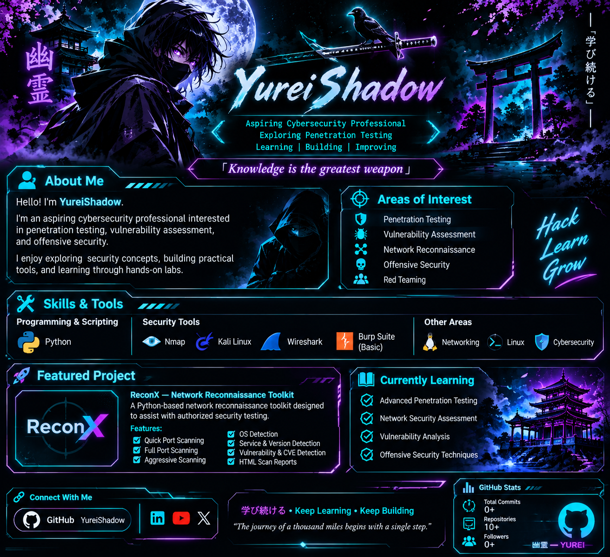

 <p align="center">
  
</p>

# 👻 YureiShadow | 幽霊

<p align="center">
  
</p>

<p align="center">
  <i>「Knowledge is the greatest weapon」</i>
</p>

---

 <div align="center">



# ⚡ ReconX

### Network Reconnaissance Toolkit

**Discover • Analyze • Understand**


A Python-based network reconnaissance toolkit designed to perform port scanning, service detection, operating system detection and vulnerability identification using Nmap and CVE data.

</div>

---

## 📌 Overview

ReconX is a network reconnaissance tool built to simplify the initial information-gathering process during authorized security assessments.

It combines multiple Nmap scanning capabilities with CVE identification and HTML report generation in a single menu-driven interface.

## 🚀 Features

| Feature | Description |
|---|---|
| Quick Port Scan | Scans the top 1,000 TCP ports |
| Full Port Scan | Scans all 65,535 TCP ports |
| Aggressive Scan | Performs detailed Nmap scanning |
| OS Detection | Identifies operating system when available |
| Service Detection | Detects running services and versions |
| CVE Detection | Looks for potential CVE matches using detected service/version information |
| HTML Reports | Generates scan results in HTML format |

## 🛠️ Technologies Used

- Python
- Nmap
- NVD CVE Database
- XML Parsing
- HTML Reporting
- Linux / Kali Linux

## ⚙️ Requirements

- Python 3
- Nmap installed on your system
- Internet connection for online CVE lookups

## 📥 Installation

**1. Clone the repository**

```bash
git clone https://github.com/YureiShadow/ReconX-Network-Reconnaissance-Tool.git
```

**2. Enter the project directory**

```bash
cd ReconX-Network-Reconnaissance-Tool
```

**3. Install Nmap**

```bash
sudo apt update
sudo apt install nmap -y
```

**4. Run ReconX**

```bash
python3 src/main.py
```

If your system requires elevated privileges for certain Nmap scan features, run:

```bash
sudo python3 src/main.py
```

## 🖥️ Usage

1. Launch ReconX.
2. Select a scanning option from the menu.
3. Enter the target IP address or domain.
4. Start the selected scan.
5. Review the detected ports, services and available vulnerability information.
6. Generate and review the HTML report.

## 🔍 CVE Identification

ReconX uses detected service and version information to search for potentially matching CVE records.

CVE matches are indicative findings and should be manually verified. Version-based matching does not prove that a target is vulnerable.

## 📊 Scan Reports

ReconX supports HTML report generation to make scan results easier to review and document.

## 🎯 Project Goals

- Simplify network reconnaissance.
- Combine multiple scanning options in one interface.
- Improve understanding of service and version detection.
- Practice Python-based cybersecurity tool development.
- Build practical experience with Nmap and vulnerability identification.

## 🔮 Future Improvements

- Additional reconnaissance modules
- Improved vulnerability matching
- Enhanced report presentation
- More detailed scan result analysis

## ⚠️ Disclaimer

ReconX is intended for educational purposes and authorized security testing only.

Do not scan systems or networks without explicit permission. The developer is not responsible for misuse of this tool.

---

<div align="center">

</div>
<p align="center">
  <b>学び続ける • Keep Learning • Keep Building</b>
</p>

<p align="center">
  <i>「The journey of a thousand miles begins with a single step」</i>
</p>
